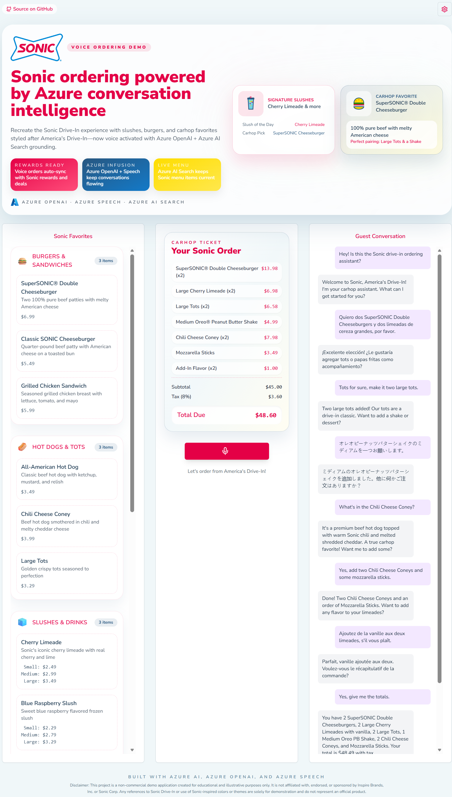
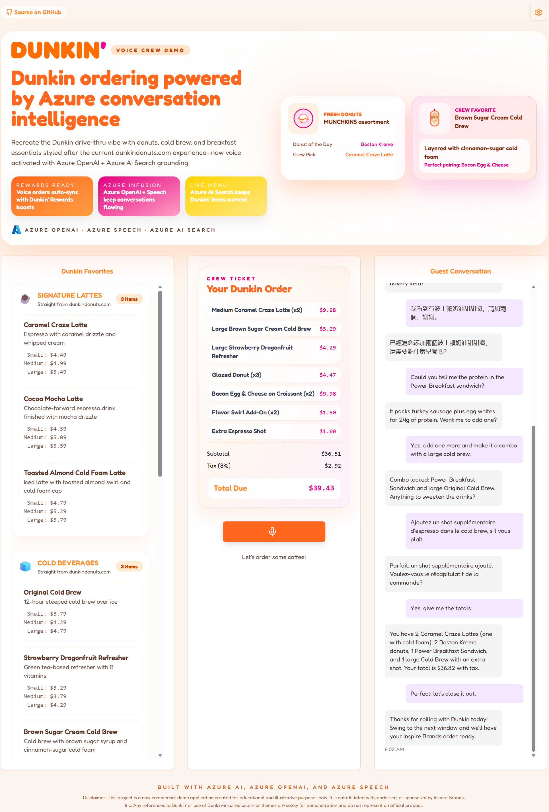
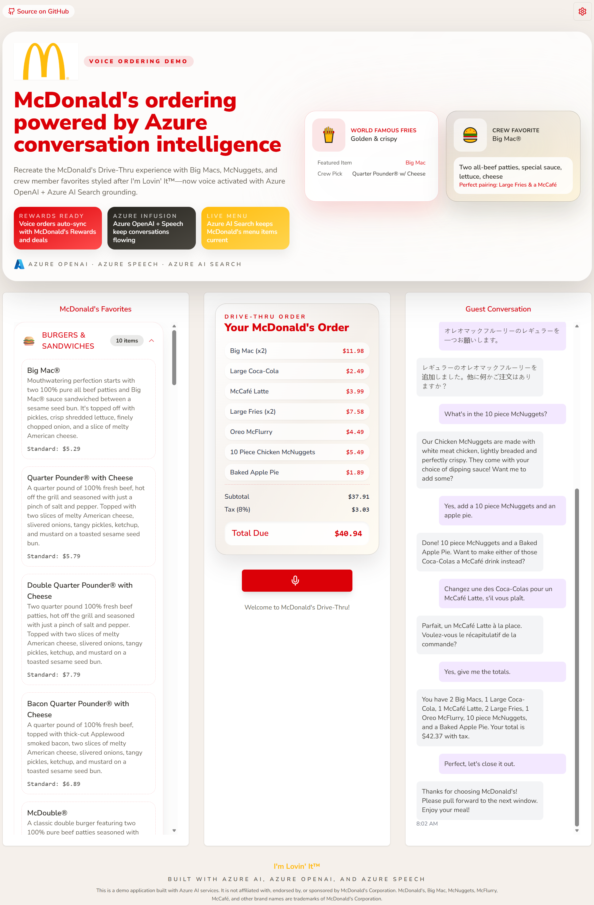

# Azure AI Drive-Thru

[](https://github.com/swigerb/AzureAIDriveThru/actions/workflows/conformance.yml?query=branch%3Adev)
[](https://github.com/swigerb/AzureAIDriveThru/blob/dev/app/Dockerfile)
[](https://github.com/swigerb/AzureAIDriveThru/blob/dev/global.json)
[](https://github.com/swigerb/AzureAIDriveThru/blob/dev/app/frontend/package.json)
[](https://github.com/swigerb/AzureAIDriveThru/blob/dev/LICENSE)

Microsoft Foundry AI Drive Thru is a multi-persona voice ordering demo for drive-thru and counter-service scenarios. One React frontend and the production Python backend serve the current `sonic`, `dunkin`, and `mcdonalds` personas, each with its own menu, prompt, theme, search index, pricing rules, dayparts, bundle rules, and demo script. The app supports a low-latency realtime voice pipeline and a cascade speech-to-text, reasoning, text-to-speech pipeline on Microsoft Foundry.

> This is a non-commercial demo application created for educational and illustrative purposes only. It is not affiliated with, endorsed by, or sponsored by the referenced brands or trademark owners. Brand references, colors, menu terms, and themes are used solely to demonstrate persona-specific voice ordering patterns and do not represent an official product.

## See it in action

**Microsoft Foundry AI Drive Thru** brings real-time voice ordering to quick serve restaurants. Every brand persona orders from its own Azure AI Search menu, server-side rules handle combos, up-sells, add-ons, and happy-hour pricing, and the voice model comes from the Microsoft Foundry model catalog.

https://github.com/user-attachments/assets/d4dc2713-5117-45cd-ba49-9aa2d707432d

*About 5 minutes, recorded from the running app using its built-in Demo Mode.*

## Screenshots

| Persona | Desktop view |
| --- | --- |
| Sonic Drive-In |  |
| Dunkin' |  |
| McDonald's |  |

## Current architecture


## Features

- Personas under `personas/`: currently `sonic`, `dunkin`, and `mcdonalds`. Each persona owns `persona.json`, `menu/menuItems.json`, prompt YAML, hints, assets, theme data, and optional demo assets.
- Persona picker with `?persona=<id>` deep links and a confirm dialog before switching when an order or conversation is active.
- Settings panel with Demo Mode, breakfast or lunch menu mode for daypart personas, a Store operations section with session-scoped per-machine up/down toggles and happy-hour Auto/On/Off control where supported, voice picker, model picker, dummy data, session-token display, and operator logging toggles.
- Demo Mode for personas that ship `assets/demo/guestScript.json`, including **Run demo: This brand**, **Full tour**, an Ava guest voice card, captions, and synthetic guest audio playback.
- Search-grounded ordering with four tools: `search`, `update_order`, `get_order`, and `reset_order`.
- Server-side pricing, 8 percent tax, order validation, live ticket updates, transcript, and off-menu rejection.
- Combo and meal handling, including Sonic component upcharges when a combo drink is upsized above the included Medium, and McDonald's whole-meal size changes.
- Daypart menu mode for Sonic and McDonald's. Dunkin' is all day.
- Happy-hour rules from persona data: Sonic standalone slushes and fountain drinks from 2 to 4 PM Central, Dunkin' standalone signature lattes and cold beverages from 2 to 5 PM Eastern, and no McDonald's happy hour. Assistant prompts are told to claim a discount only when the tool result names discounted lines.
- Dunkin' regular coffee handling, where regular means cream and sugar, plus MUNCHKINS flavor and count choices with spoken pronunciation guidance.
- Echo suppression, barge-in, turn taking, silent-guest nudges, session resume, and rate-limit recovery.
- Keyless Azure access with `DefaultAzureCredential`, managed identity, and local auth disabled on provisioned Azure AI Search and AIServices resources.

## How it works

### Realtime pipeline

The browser streams microphone PCM over one `/realtime` WebSocket. The Python backend relays audio to the configured Foundry realtime deployment, with default catalog id `gpt-realtime-2.1-mini`, voice `marin`, server VAD threshold `0.5`, 300 ms prefix padding, 200 ms silence duration, the active persona prompt, and persona-specific tool schemas. Guest speech transcription defaults to `whisper-1`. The model can call ordering tools, and the backend returns tool results to both the model and the frontend ticket.

`gpt-realtime-2.1` is a selectable, non-default alternative to `gpt-realtime-2.1-mini`. It uses deeper reasoning at the cost of latency, which is unnecessary for straightforward transactional intents.

### Cascade pipeline

The cascade pipeline uses the same WebSocket and frontend contract. The backend segments guest audio locally, transcribes it with `gpt-4o-transcribe`, sends text and the same tool schemas to a Foundry chat model, then returns audio from `gpt-4o-mini-tts`. The catalog contains `gpt-5-mini` and `phi-4` for reasoning. The standard deployment creates both, while current persona allow-lists select `gpt-5-mini`.

Cascade turns are slower than realtime: with `gpt-5-mini` and tool calls, a guest turn took roughly 10 to 35 seconds in testing before the reply played. The chat model occasionally repeats a sentence or reads a tool's upsell hint aloud. A short pause inside a guest phrase can split it into two turns; audio from a turn cancelled before its transcript commits is carried into the next turn. While a reply plays, guest audio is suppressed to avoid echo, so speech that overlaps the assistant can be lost. The cascade speech threshold (`vad.cascade_energy_threshold`) has been verified with synthetic speech, not yet with a physical microphone.

## Azure services

`azd` provisions or connects these resources:

- Microsoft Foundry `AIServices` account, kind `AIServices`, SKU `S0`, with deployments from `infra/model-deployments.json`: `gpt-realtime-2.1`, `gpt-realtime-2.1-mini`, `text-embedding-3-large`, `gpt-5-mini`, `phi-4`, `gpt-4o-transcribe`, and `gpt-4o-mini-tts`.
- Azure AI Search, Basic tier by default, with one index per persona from each `persona.json` `search.indexName`.
- Azure Container Apps hosting one container app that serves the built frontend and Python backend.
- Azure Container Registry, Log Analytics, Storage, and a user-assigned managed identity.
- Microsoft Entra ID in-app auth. EasyAuth is off. The SPA uses MSAL and the API validates JWTs with the `DriveThru.User` app role.

## Quick start

### Prerequisites

- Windows PowerShell 7 or a compatible shell.
- Azure Developer CLI (`azd`), Azure CLI, Docker, Node.js 24 LTS (24.15+), Python 3.15 (3.12-3.14 remain supported), and Git.
- The .NET 11 RC3 SDK pinned in `global.json`, only if you run the C# backend or conformance suites.
- Azure and GitHub authentication for deployment workflows.

### Dependency compatibility

The frontend uses React 19, Vite 8, TypeScript 7, and Vitest 5. Vite's
`legacy.inconsistentCjsInterop` option is required for the CommonJS default export published by
`react-use-websocket`. Keep `package-lock.json` and NuGet `packages.lock.json` in sync with
manifest changes. Dependabot checks npm, pip, NuGet, containers, and GitHub Actions against
`dev`; see [contributor guidance](CONTRIBUTING.md#dependency-maintenance).

Current compatibility constraints:

- The C# backend targets .NET 11 RC3, a prerelease SDK/runtime pinned in `global.json`. Moving to
  stable .NET 10 requires a separate target-framework change.
- `azure-ai-inference` uses `1.0.0b9`; no stable release is available.
- PyYAML 6.0.3 has no Windows wheel for Python 3.15. Setup scripts, CI, and the production image
  set `PYYAML_FORCE_LIBYAML=0` to use the supported pure-Python parser. The devcontainer uses
  Python 3.13 because its registry does not offer a Python 3.15 image.
- Transitive npm versions follow their parent packages' supported ranges. Avoid overrides that
  force incompatible versions; upstream `latest` can also be a prerelease.

Windows checks do not replace the Linux container build and Gunicorn startup checks in CI.

### Local development

Run commands from the repository root. On Windows, `pwsh ./scripts/start.ps1` provisions
`.venv`, installs backend requirements, builds the frontend with `VITE_AUTH_MODE=Development`
(unless already set), and launches the Python backend. On macOS/Linux, use
`sh ./scripts/start.sh`; the shell scripts use the same root `.venv`, including search indexing.
Neither command installs test tooling. For Python tests, first install
`app/backend/requirements-dev.txt` with that virtual environment's interpreter.

To select Python 3.15 explicitly on Windows before running the helper:

```powershell
py -3.15 -m venv .venv
$env:PYYAML_FORCE_LIBYAML='0'
.\.venv\Scripts\python.exe -m pip install -r app/backend/requirements-dev.txt
```

On macOS/Linux use `python3.15 -m venv .venv`, then
`PYYAML_FORCE_LIBYAML=0 .venv/bin/python -m pip install -r app/backend/requirements-dev.txt`.
The local launchers serve the built SPA rather than a Vite hot-reload server. Gunicorn
production mode (`--production` on the shell launcher) requires a Unix host and a previously
built frontend; it is not a Windows production server.

### Deploy with azd

The deployed app requires Entra ID. Create its app registration and set the tenant, client, and
API scope values before building the frontend. Follow the staged auth and ingress procedure in
[DEPLOY.md](DEPLOY.md).

`DEPLOY_DOTNET_APP` defaults to `false`. While it is disabled, target the Python service explicitly
(for example, `azd deploy backend`); after enabling and provisioning C#, target `backend-dotnet`.
Do not run bare `azd up` or `azd deploy` while the C# service is disabled.

## Choose your backend

The app has two backend implementations behind the same frontend and the same `/realtime` wire
contract: `app/backend` (Python, aiohttp -- the reference implementation) and
`app/backend-dotnet` (C#, .NET 11, ASP.NET Core). Both can run side by side
in the same environment, sharing the same Foundry account, Azure AI Search service, and managed
identity (`docs/persona-architecture.md` section 14).

**When to pick which:**

- **Python** is the reference backend: it lands new features first and is the one to use if you
  only need one backend running.
- **C#** is for .NET-first teams, or once you want to validate both legs for a release -- it's
  feature-equivalent once the conformance suite is green on both (see below), not before.

**What parity means.** "Feature-equivalent" is enforced, not assumed: the shared, language-neutral
conformance harness at `tests/conformance/` drives both backends' `/realtime` WebSocket and REST
surface through the same black-box scenarios (ordering rules, persona switching, auth, resume,
rate-limit recovery, and more) and pins the two backends to identical responses. `dev` only merges
to `main` after the full validation plan in `docs/persona-architecture.md` section 12 is green,
which requires the conformance suite passing on both backends. Run it with:

```bash
# Python is the harness default; it requires the root .venv and backend dependencies.
dotnet test tests/conformance/Conformance.slnx --filter "Category!=Browser"

# Explicitly select C#; omitting this variable tests Python again.
CONFORMANCE_BACKEND=dotnet dotnet test tests/conformance/Conformance.slnx --filter "Dotnet=ready&Category!=Browser"
```

These examples use Bash environment syntax. In PowerShell, set
`$env:CONFORMANCE_BACKEND='dotnet'` before the second command. Browser scenarios run separately
with a Playwright-supported browser channel; see [the harness guide](tests/conformance/README.md#local-validation).

**How to switch.** Both backends can be deployed at once behind one frontend build, and a guest can
move between them without losing their persona or model choice:

- In a running app with both backends deployed, the header's Python / C# (.NET) picker
  (`app/frontend/src/components/ui/backend-picker.tsx`) is a real navigation between each backend's
  own hostname -- there's no proxy -- that carries the current `persona`/`model` selection across
  the hop.
- The picker itself is driven by `/api/personas`' `backends[]` list, which the frontend reads to
  decide whether to show it at all: a single-backend deployment (only `BACKEND_URI` set, no
  `BACKEND_DOTNET_URI`) never shows the picker, since there's nothing to switch to.

**How to deploy each.** Both backends deploy from the same `azd` environment, the same
`infra/main.bicep`, and the same Entra app registration:

- **Python** deploys by default on every `azd up` -- see [Deploy with `azd`](#deploy-with-azd)
  above.
- **C#** is opt-in per environment via `DEPLOY_DOTNET_APP`/`deployDotnetApp`, off by default: see
  [DEPLOY.md's .NET container app section](DEPLOY.md#net-container-app) for the `azd env set`
  steps, ingress-last rollout, and rollback. Enable it only in environments where the second app
  is approved and intended.

**Live comparison.** `scripts/ab_compare.py` drives scripted orders against both backends' live
`/realtime` endpoints and measures latency, tool correctness, session readiness, and container
CPU and memory. Run `python scripts/ab_compare.py --help` for usage.

## Repository layout

```text
app/backend/          Python aiohttp backend used in production
app/backend-dotnet/   C# .NET 11 parity backend
app/frontend/         React and TypeScript frontend
personas/             Persona data, menus, prompts, assets, and themes
infra/                Bicep modules and model deployment data
scripts/              azd hooks, search indexing, auth setup, smoke checks, live A/B comparison
tests/conformance/    Black-box conformance suite for backend parity
docs/                 Architecture, ADRs, operations docs, and demo script
```

## Testing

Use the smallest check that covers your change. Common checks are:

```powershell
# Activate .venv first, or substitute .\.venv\Scripts\python.exe for python.
# Install requirements-dev.txt first (see Local development).
# Python backend targeted tests
python -m pytest app/backend/tests/test_rebrand_verification.py app/backend/tests/test_tools_attach.py

# ab_compare.py's own unit tests (fakes only -- no live Azure, no network)
python -m pytest scripts/tests/test_ab_compare.py

# .NET backend unit tests, requires .NET 11 SDK
dotnet test app/backend-dotnet/Backend.slnx

# Non-browser conformance against C# (the default without this variable is Python)
$env:CONFORMANCE_BACKEND='dotnet'
dotnet test tests/conformance/Conformance.slnx --filter "Dotnet=ready&Category!=Browser"
Remove-Item Env:CONFORMANCE_BACKEND

# C# tooling tests
dotnet test tools/dotnet/Tooling.slnx

# Frontend build and tests
cd app/frontend
npm test
$env:VITE_AUTH_MODE='Development'
npm run build
```

The CI rebrand ratchet scans tracked source and Markdown files for brand-word drift. Cross-brand documentation is intentionally allowed only in documented files that compare personas by design.

## More docs

- [Demo script](docs/DEMO_SCRIPT.md)
- [Persona architecture](docs/persona-architecture.md)
- [Order resume](docs/order_resume.md)
- [Rate-limit recovery](docs/rate_limit_recovery.md)
- [A/B comparison report](docs/ab-report.md)
- [ADR-001: persona architecture](docs/adr/ADR-001-persona-architecture.md)
- [ADR-002: Entra authentication](docs/adr/ADR-002-entra-authentication.md)
